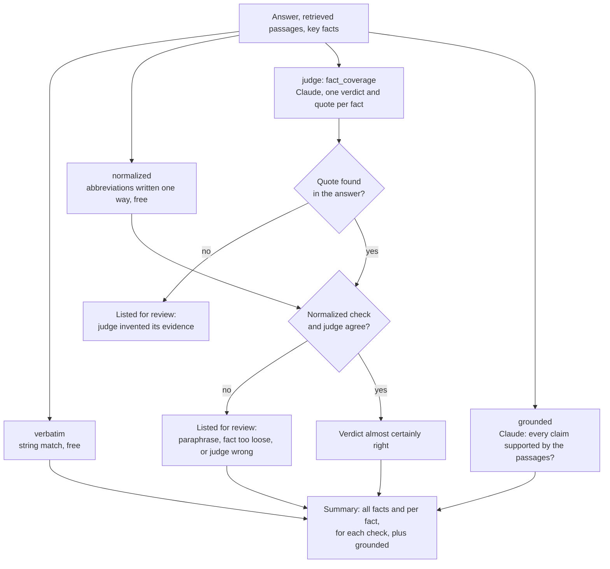

# Evaluation

This document explains how the RAG backend is evaluated with a golden dataset: what the dataset contains, how it is built, what the metrics mean, and what the evaluation has found so far. It builds on [architecture.md](architecture.md), especially the sections on filter extraction and search.

**Contents**

1. [Why evaluate](#1-why-evaluate)
2. [The golden dataset](#2-the-golden-dataset)
3. [Metrics](#3-metrics)
4. [Why filters are inferred, and why that can fail](#4-why-filters-are-inferred-and-why-that-can-fail)
5. [Running the evaluation](#5-running-the-evaluation)
6. [Findings](#6-findings)
7. [Pitfalls](#7-pitfalls)

---

## 1. Why evaluate

A RAG system has many settings that change answer quality: the prompts, the models, chunk size, `top_k`, the filter rules. Trying a few questions in the UI after a change shows whether *those* questions still work, not whether the system as a whole got better or worse.

A **golden dataset** is a fixed, reviewed set of questions with known right answers. Running all of them after every change turns 'it seems fine' into numbers that can be compared between runs. It is regression testing for RAG.

The evaluation scores **retrieval** first: does the search find the article that answers the question? The LLM can only answer from the passages it is given. If the right article is not among them, no prompt can fix the answer. It then scores the **answers**: do they contain the key facts, and is every claim supported by the retrieved passages?

## 2. The golden dataset

[evals/golden.jsonl](../evals/golden.jsonl) holds one case per line:

```json
{"id": "q0007",
 "question": "What did USDA project for U.S. corn stocks on Aug. 31, 1987?",
 "expected_doc_ids": ["reuters-15853", "reuters-15875"],
 "reference_answer": "USDA projected U.S. corn stocks on Aug. 31, 1987, at 5,240 mln bushels, ...",
 "key_facts": ["5,240"],
 "style": "undated",
 "source_title": "U.S. SUPPLY/DEMAND HIGHLIGHTS",
 "source_date": "1987-04-09",
 "generated_by": "gpt-5.4-mini",
 "reviewed": true}
```

| Field | Meaning |
|---|---|
| `question` | What a user would type |
| `expected_doc_ids` | Articles that answer the question. Retrieval is scored against these |
| `reference_answer`, `key_facts` | A correct answer and the facts it must contain. Answers are scored against the key facts; the reference answer is for review |
| `style` | Describes the question, not the article: `dated` if it mentions a date or period ('on March 24', 'in Jan/Feb 1987', 'third-quarter'), `undated` if it mentions none. Checked automatically |
| `source_title`, `source_date` | The article the question was generated from, to make review easier |
| `reviewed` | Whether a person has checked the case |
| `notes` | Optional. What the review decided and why, e.g. 'Added reuters-3065: same story, same day' |

### Step 1: draft cases

[evals/generate.py](../evals/generate.py) builds cases from the corpus itself:

1. Sample articles that are indexed, have a date and a topic, and are at least 400 characters long. No single topic may make up more than 25% of the cases; otherwise about 40% would be earnings reports.
2. Give each article to an LLM (`gpt-5.4-mini`) and ask for a structured reply with three fields, all written from the article in one call:

   | Field | Instruction to the LLM |
   |---|---|
   | `question` | One short question (at most 20 words) that this article answers, specific enough that it is the best match among 19,000 articles |
   | `reference_answer` | One or two sentences, only facts stated in the article |
   | `key_facts` | One to three facts the answer must contribute beyond the question: verbatim from the article, as short as possible, never repeating the question |

3. Randomly make about half the questions `dated` and the rest `undated`. Dated questions test filter extraction; undated ones test plain similarity search.

The trick is that **the article the question was written from is the expected answer**, so no labelling is needed. Running the script again appends new cases and skips articles already in the file.

**Key facts come from the article, not from the question.** They are what a correct answer must *add* to the question. Key facts do not affect the retrieval scores. They are for scoring answers later, where a cheap first check is whether an answer contains them ('28,526', '17.6 pct'). That only works if they follow four rules:

| Rule | Bad | Good | Why |
|---|---|---|---|
| Verbatim from the article | 'Malaysia 28,526 tonnes' (the article says 'Malaysia has been allocated an export quota of 28,526 tonnes') | '28,526' | Checked by exact string matching |
| Never repeats the question | 'Fidelcor Business Credit Corp' for 'What did Fidelcor Business Credit Corp agree to buy…?' | 'loan portfolio' | Every answer repeats the question's names, so the check would always pass |
| As short as possible | 'most of Lazere's loan portfolio' | 'loan portfolio' | A correct answer may word the rest differently ('most of its loan portfolio') |
| Essential | the group total '96,000 tonnes' for a question about Malaysia's and Indonesia's quotas | (left out) | A good answer that leaves it out would be counted as wrong |

**Shape versus content.** The reply's *shape* (a question, a reference answer, a list of key facts) is enforced by OpenAI's structured outputs, from the Pydantic model `GeneratedCase`. The *content* rules need the article, which a JSON schema cannot express, so a Pydantic validator checks them after parsing, with the article passed as validation context. The rules 'verbatim' and 'never repeats the question' are checked by [evals/checks.py](../evals/checks.py); if a reply breaks one, the generator sends the error back to the LLM ('key fact "Aldo Hofmeister" only repeats the question') and asks again, up to three attempts, and skips the article if it still fails. Whether a fact is as short as possible and essential cannot be checked automatically; that stays with the prompt and the review. The same check marks key facts ✓ or ✗ in the review UI. The question's style is validated the same way: an `undated` question that names a month, year, quarter or similar period is sent back, and so is a `dated` one that names none.

The 'repeats the question' check rejects a fact only if *all* its words are in the question (ignoring function words and company suffixes such as 'Corp'), so '30.50 dlrs per share' passes for a question about the price per share: '30.50' is new.

```bash
.venv/bin/python -m evals.generate --n 50
```

`gpt-4o-mini` was tried first and ignored the date rules ('this week', 'next week' instead of a date); `gpt-5.4-mini` followed them.

### Step 2: review the cases

Generated cases are drafts. Review is what makes the dataset *golden*. The review UI shows one case at a time, with the full text of the expected articles (key facts highlighted, and flagged if not found verbatim) and the articles the latest evaluation runs retrieved instead. Saving writes straight to `evals/golden.jsonl`, so `git diff` shows what the review changed:

```bash
.venv/bin/pip install -r requirements-dev.txt
.venv/bin/streamlit run evals/review_app.py
```

For each case with `"reviewed": false`:

- **Delete or rewrite vague questions** that many articles answer equally well.
- **Add equally good articles to `expected_doc_ids`.** Reuters often has several versions of one story, such as a short highlights item and a detailed table. If the second one is retrieved, that is not a miss. See [deciding on another article](#deciding-on-another-article) below.
- **Check the reference answer** against the article: correct, complete, only facts from the article.
- **Check the key facts** against the four rules above. The UI marks each one ✓ or ✗ for 'verbatim' and 'never repeats the question'; whether it is as short as possible and essential is your call. Remove facts a good answer could leave out.
- **Check the style:** an `undated` question must not mention a date or period such as 'Jan/Feb'. This is checked automatically; if you rewrite a question, fix the style to match.
- **Never change a case to make a system failure go away.** If the right article was excluded by a wrong filter, the case is correct and the system is not.
- Set `"reviewed": true`, and write what you decided in `notes` if you changed anything.

After editing `golden.jsonl` by hand, check all cases against the rules (exit code 1 on violations, so it can run in CI):

```bash
.venv/bin/python -m evals.checks
```

**Start with the misses.** A case the system already ranks first rarely hides a problem with `expected_doc_ids`. For a miss, the articles retrieved instead are the candidates for equally good answers, so you only judge those few, never the whole corpus. Search benchmarks have been built this way for decades ('pooling'). An equally good article that no run ever retrieves stays unknown; it does not distort the scores, and it shows up for review once a better version of the system retrieves it.

#### Deciding on another article

In the review UI, the articles a run retrieved are listed under 'Evaluation runs'; open one to read it with the key facts highlighted. The column without auto filters is usually the better candidate list, since no wrong filter has removed anything. Then ask one question: **would a user asking this question be fully satisfied with this article alone?**

| Add it if… | Don't add it if… |
|---|---|
| It is the same story again: an update, a repeat, a short version | It is only on the same subject |
| It contains the facts of the reference answer. Many highlighted key facts are a strong sign | It answers only part of the question |
| A user would not care which of the two they got | It gives different figures, or another source's view |

**Every expected article must contain every key fact.** Both fields describe the correct answer: `expected_doc_ids` for retrieval scoring, `key_facts` for answer scoring. If an expected article lacked a key fact, retrieving it would count as a hit while an answer built from it could not contain the fact. When the two disagree, one of them is wrong, and you decide which: remove the article if it does not fully answer the question, or shorten the fact if it is worded too specifically ('2.5 percent' versus '2.5 pct' → '2.5'). The review UI shows `key facts n/m` for every article and warns on saving; nothing is changed automatically.

**Duplicates no run retrieved.** The candidates from the runs only cover what a run happened to retrieve. The review UI also lists **possible duplicates** of the expected articles: articles whose first chunk lies within distance 0.15 of an expected article's first chunk. Known duplicates were at most 0.115 apart, related but different stories at least 0.197. Distance alone misleads for recurring reports: last week's cocoa purchases or another quarter's housing starts lie as close as a true duplicate but carry other figures. So candidates containing all key facts are shown, and the others are collapsed. For an overview of all cases:

```bash
.venv/bin/python -m evals.duplicates
```

Examples from the first review:

- **q0008, added.** reuters-3065 has the same title, the same day and the same '2.5 pct' growth figure: the same story.
- **q0004, not added.** The higher-ranked Colombia articles are about coffee export registrations, but none states the registration price the question asks for.
- **q0039, not added.** The higher-ranked article is a growth forecast from the DIW institute, not the Bundesbank: same subject, different answer.

## 3. Metrics

For each question, the search returns the `top_k` (default 4) closest chunks. Chunks of the same article are merged, which gives a ranked list of articles. Every metric is based on **where the expected article lands in that list**.

**From chunks to articles.** Search works with chunks (up to 1,000 characters each); the metrics score articles. Take q0025, 'What would Allis-Chalmers keep under its restructuring plan?', whose expected article is reuters-1860:

| Chunk rank | Chunk | From article |
|---|---|---|
| 1 | reuters-19849:0 | reuters-19849, 'Allis-Chalmers lists main creditors' |
| 2 | reuters-1860:0 | reuters-1860, 'Allis-Chalmers proposes restructuring' |
| 3 | reuters-1860:1 | reuters-1860 |
| 4 | reuters-1860:2 | reuters-1860 |

Each article counts once, in the order it first appears, so the four chunks become two articles: 1. reuters-19849, 2. reuters-1860. The expected article is ranked second: no hit@1, a hit@4, and 0.5 towards the MRR (`doc_rank` in [evals/evaluate.py](../evals/evaluate.py)).

The *k* in hit@k is therefore the number of chunks searched (`top_k`), not of articles: depending on the question, the four chunks come from one to four different articles. The articles are what is scored, because the golden dataset names the article that holds the answer (`expected_doc_ids`), not a chunk: which chunk contains it depends on where the text was cut. Once any chunk of that article is retrieved, the answer model sees its text.

| Metric | Per question | Over all questions |
|---|---|---|
| **hit@1** | 1 if an expected article is ranked **first**, else 0 | Share of questions where it came first |
| **hit@k** | 1 if an expected article is **among the retrieved ones**, else 0 | Share of questions where it was retrieved at all |
| **MRR** (Mean Reciprocal Rank) | 1/rank: 1st → 1, 2nd → 0.5, 3rd → 0.33, 4th → 0.25, not retrieved → 0 | Average of those values |
| **filt.out** | 1 if the applied filters **excluded** every expected article | Share of such questions |

A worked example with four questions:

| Question | Rank of expected article | hit@1 | hit@4 | 1/rank |
|---|---|---|---|---|
| A | 1 | 1 | 1 | 1.00 |
| B | 3 | 0 | 1 | 0.33 |
| C | 1 | 1 | 1 | 1.00 |
| D | not retrieved | 0 | 0 | 0 |
| **Score** | | **50%** | **75%** | **MRR 0.58** |

How to read them:

- **hit@k** is the minimum requirement: the LLM sees only these passages.
- **hit@1** is stricter: with the best source on top, a good answer is more likely.
- **MRR** combines the two into one number; second place counts as half a hit instead of a miss.
- **filt.out** is a diagnostic, not a quality score. It says *why* a miss happened: the article was removed by a filter before the search started, so it could not be found at any rank. A high value points at filter extraction rather than at the embeddings.

### Answer metrics

Answers are scored by four checks, run as MLflow scorers ([evals/scorers.py](../evals/scorers.py)). The two judges are Claude (`judge_model`, default `claude-sonnet-5-5`), so the answers (`gpt-4o-mini`) are not graded by a model of their own family.

| Check | Kind | Passes if | Misses |
|---|---|---|---|
| **verbatim** | Code, free, deterministic | Every key fact appears verbatim in the answer, as in the articles | Paraphrases: '2.5 percent' for '2.5 pct' |
| **normalized** | Code, free, deterministic | The same, after writing abbreviations one way on both sides (`ABBREVIATIONS` in [evals/checks.py](../evals/checks.py)): '2.5 percent' and '2.5 pct' both become '2.5 pct' | Paraphrases, numbers in words ('nine cts' vs '9 cents') |
| **judge** (`fact_coverage`) | LLM judge, one verdict per fact | The judge finds every key fact in the answer, in any wording, and quotes the words that state it | Whatever the judge gets wrong; hence the quote |
| **grounded** | MLflow's built-in `RetrievalGroundedness` judge | Every claim in the answer is supported by the retrieved passages | Wrong facts that the passages also contain |

Each is reported per case ('all facts') and, for the two fact checks, per fact. The key facts measure *completeness*; groundedness measures *faithfulness*. An answer can be complete and still invent a claim, or faithful and still miss the point, so neither replaces the other.

All four checks run on every answer; the judges are not a fallback for when the free checks fail. What happens afterwards depends on whether the checks agree:



**Why a free check and a judge.** Where they agree, the verdict is almost certainly right. Where they disagree, one of them is wrong, and those are the cases to read. The report lists them for the normalized check; the strict verbatim check is kept to show how much the normalising adds.

| Normalized | Judge | Usually means |
|---|---|---|
| ✗ | ✓ | A paraphrase, which the judge rightly accepts; or a lenient judge |
| ✓ | ✗ | A key fact that matches by accident (too short, too common); or a wrong judge |

**Checking the checker.** The judge must quote the passage of the answer that states each fact, and the quote is searched for in the answer. A quote that is not there means the judge invented its evidence. The review UI marks the quote blue next to the yellow verbatim matches, so a person sees at a glance what the judge accepted.

MLflow's built-in `Correctness` judge also accepts key facts (as `expected_facts`), but returns one verdict per answer and no quote, so it cannot show which fact is missing or be checked against the answer.

## 4. Why filters are inferred, and why that can fail

Similarity search compares *meaning*. It finds 'articles about oil prices' well, but a date in the question only shifts the embedding slightly; it does not act as a constraint. The corpus has 566 crude-oil articles spread over eight months, and without filters the question 'What happened to oil prices on October 19, 1987?' retrieved articles from March and April.

Metadata filters are exact: `date_int` between 19871019 and 19871020, `topics` contains `crude`. But users type free text, not form fields. So a small LLM first **translates the question into filters**, and the database applies them before ranking:

```
"What happened to oil prices on October 19, 1987?"
   ↓ LLM (filter extraction)
date 1987-10-19 – 1987-10-20, topic = crude
   ↓ database keeps only matching articles
   ↓ similarity search ranks the rest
```

Explicit filters from the UI settings are the alternative. They always win over inferred ones (see [architecture.md](architecture.md#servicesfilterspy--filter-extraction)).

A filter is all or nothing. When the inferred value is right, it removes noise. When it is wrong, the right article becomes **impossible to find**, and the fallback does not help as long as the wrong filter still matches *some* articles:

```
question ─► wrong filter ─► right article removed ─► 4 other articles found ─► no fallback
```

- **Dates are low risk.** The question states them, so the LLM mostly copies them.
- **Topics are high risk.** Topic codes were assigned by Reuters editors in 1987, from a fixed list of 119. The LLM has to guess which code an editor chose, and that guess is subjective.

The evaluation confirmed this, so the extracted topic is no longer applied by default (`topic_mode` = `off`, see [the findings](#2026-10-19-topic-as-filter-boost-or-not-at-all)). The topic is still extracted, and `topic_mode` = `filter` restores the behaviour described above.

## 5. Running the evaluation

[evals/evaluate.py](../evals/evaluate.py) runs each question through the same retrieval pipeline as `/query` ([app/services/retrieval.py](../app/services/retrieval.py)), so the scores describe the real system and not a copy of it.

```bash
.venv/bin/python -m evals.evaluate                    # as /query runs
.venv/bin/python -m evals.evaluate --no-auto-filters  # plain similarity search, for comparison
.venv/bin/python -m evals.evaluate --reviewed-only    # only reviewed cases
.venv/bin/python -m evals.evaluate --top-k 8          # retrieve more chunks
.venv/bin/python -m evals.evaluate --topic-mode boost --topic-boost 0.05  # how an extracted topic is used
```

Output: the metrics overall and per `style`, then every case not ranked first with its applied filters and the retrieved titles. The full results and the settings used are written to `evals/runs/` (git-ignored), so two runs can be compared.

Cases whose articles are not in the index (e.g. after `ingest_reuters --limit 500`) are skipped and counted separately, not scored as misses.

### Answers

[evals/score_answers.py](../evals/score_answers.py) runs each question through retrieval and the same prompt and model as `/query`, records each as an MLflow **trace** (retrieval as a `RETRIEVER` span, every OpenAI call as a child span), and scores the traces with `mlflow.genai.evaluate`. It needs `ANTHROPIC_API_KEY` in `.env` for the judges. A run of 50 cases costs well under a dollar.

```bash
.venv/bin/pip install -r requirements-dev.txt
.venv/bin/python -m evals.score_answers               # as /query runs
.venv/bin/python -m evals.score_answers --limit 5     # a cheap trial run
.venv/bin/python -m evals.score_answers --ids q0012   # rescore single cases after a fix
.venv/bin/mlflow ui --backend-store-uri sqlite:///mlflow.db   # browse runs, traces and verdicts
```

Output: the answer metrics overall and split by whether an expected article was retrieved, then every disagreement between the two fact checks and every ungrounded answer with the judge's reasoning. The full results go to `evals/runs/*-answers.json` for the review UI ('Answers to check' view), and the run, its parameters and every trace with its verdicts to the local MLflow store (`mlflow.db`, git-ignored). On Databricks, only the tracking URI changes.

Answers are generated before `mlflow.genai.evaluate` runs, not by its `predict_fn`: that runs each call in a new event loop, and the app's async OpenAI client is bound to one.

## 6. Findings

Each entry records what was measured, on which data, and what follows from it.

### 2026-10-19: baseline, inferred topic filter hurts retrieval

**Setup.** 50 generated cases, **not yet reviewed**. `top_k` 4, `text-embedding-3-small`, `gpt-5.4-nano` for filter extraction, full corpus indexed.

| | n | hit@1 | hit@4 | MRR | filt.out |
|---|---|---|---|---|---|
| **With auto filters** (as `/query` runs) | 50 | 74% | 86% | 0.80 | 10% |
| dated | 23 | 87% | 96% | 0.91 | 4% |
| undated | 27 | 63% | 78% | 0.70 | 15% |
| **Without auto filters** | 50 | 80% | 96% | 0.88 | 0% |
| dated | 23 | 87% | 100% | 0.93 | 0% |
| undated | 27 | 74% | 93% | 0.83 | 0% |

**Observation.** Filter extraction makes retrieval *worse* overall (hit@4 86% vs 96%). The loss is in the undated questions, which contain no date, so the filter responsible must be the topic. The five filtered-out cases confirm it:

| Question | Inferred filter | Article's labels | Cause |
|---|---|---|---|
| What U.S. joint venture did Nippon Mining sign with Conoco Inc? | `acq` | `crude` | wrong topic |
| What is Bank of British Columbia's revised shareholder distribution estimate after selling its assets? | `acq` | `earn` | wrong topic |
| Why is Cehave NV Veghel challenging the European Community grain co-responsibility levy? | `grain` | `meal-feed` | wrong topic |
| What pact did California Micro Devices and Grumman's Tachonics sign in March? | March, `acq` | `strategic-metal` | wrong topic |
| How much beef did Argentina export in Jan/Feb 1987? | Jan–Feb | published Mar 11 | event date ≠ publication date |

Take the Nippon Mining case. The LLM read 'joint venture … sign with' and chose `acq` (Mergers/Acquisitions), a reasonable guess. But Reuters labelled the story `crude`, because it is about oil. The filter removed the article before the search started; four unrelated `acq` articles were found instead, so the fallback never ran. Without filters, the article was retrieved.

**Interpretation.** The inferred date filter is neutral to helpful (dated questions: 87% hit@1 either way). The inferred topic filter is the main source of misses: 4 of 5 filtered-out cases. This is the limitation listed in [architecture.md](architecture.md#7-known-limitations) ('the fallback only triggers on zero results'), now with a number.

**Caveats.** The cases are unreviewed and 50 is a small sample: one case moves a score by 2 percentage points. The direction is clear, though: each filtered-out case was checked against the article's labels by hand.

**Options to evaluate next:**

- Infer only dates; drop the inferred topic.
- Use the topic to boost matching articles in the ranking instead of excluding the others.
- Fall back to an unfiltered search not only on zero results but also when the filtered results are poor matches.

### 2026-10-19: review of the misses, and filter extraction is not deterministic

**Setup.** The 13 cases not ranked first in the baseline were reviewed (now `reviewed: true`, with `notes`); the other 37 are not yet. Same settings as the baseline. The auto-filter evaluation was run three times, plain search once.

**Review.** Only one of the 13 questions needed rewriting. The misses fell into four groups:

| Group | Cases | Fix |
|---|---|---|
| **Filter excluded the article.** Plain search ranks it first | q0014, q0015, q0017, q0024, q0033 | None. The case is right and the system is wrong; these are the tests for a filter fix |
| **Same story twice.** Reuters ran an update or repeat, and the system found the other copy | q0008, q0027, q0028, q0040 | Added the copies to `expected_doc_ids` |
| **Genuine ranking miss** | q0004, q0012, q0039 | None |
| **Question too vague**, answered by dozens of articles | q0021 | Rewritten, plus a duplicate added. Still a genuine miss: the answer is in the second chunk of a long G-7 statement, and analysis articles about the statement rank higher |

The review also caught a broken reference answer (q0028, cut off mid-sentence).

**Results after the review:**

| | hit@1 | hit@4 | MRR | filt.out |
|---|---|---|---|---|
| With auto filters, run 1 | 82% | 86% | 0.84 | 10% |
| With auto filters, run 2 | 80% | 84% | 0.82 | 12% |
| With auto filters, run 3 | 78% | 82% | 0.80 | 14% |
| **Without auto filters** | **88%** | **96%** | **0.92** | 0% |

**Finding 1: the gap is now entirely the filter.** Fixing the duplicates raised both configurations, and the remaining genuine misses (q0004, q0012, q0021, q0039) occur with and without filters. What separates the two is the cases where filters excluded the right article: hit@4 is 96% without filter extraction and 82–86% with it.

**Finding 2: filter extraction gives different results on identical runs.** Nothing changed between the three runs, yet:

| Case | Inferred topic in runs 1 / 2 / 3 | Article's labels |
|---|---|---|
| q0014 California Micro / Grumman pact | none / `acq` / none | `strategic-metal` |
| q0024 Nippon Mining / Conoco | none / none / `acq` | `crude` |
| q0027 Saudi Arabia / Petrobras credit | `instal-debt` in all three (none in the baseline) | `crude` |

The search itself is deterministic: same question, same embedding, same ranking. The variation comes from the extraction LLM. Consequences:

- A difference of a few points between two single runs can be noise. Compare configurations over several runs.
- A user asking the same question twice can get different sources.
- q0027 shows the failure mode again: the model matched 'credit guarantees' to `instal-debt` (Instalment Debt/Consumer Credit) on shared words, against the prompt's instruction to match on meaning.

**Finding 3: the topic filter also helps, but less often than it hurts.** In q0025 (Allis-Chalmers restructuring) and q0026 (Dauphin Deposit acquisition), the inferred `acq` filter moved the right article from rank 2 to rank 1, in all three runs. Against that, 5–7 cases per run lose the right article entirely. Any fix should keep the benefit if it can, e.g. by using the topic to boost matching articles rather than to exclude the others.

**Next.** Review the remaining 37 cases, then compare the filter options from the baseline entry over several runs each.

### 2026-10-19: key facts repeated the question

**Observation.** During review, key facts turned out to name what the question already names: 'Fidelcor Business Credit Corp' for 'What did Fidelcor Business Credit Corp agree to buy…?'. A scan of all 50 cases flagged 41; most listed the company or person from the question, five facts did not appear verbatim in the article, and many were longer than needed or not essential. The cases already marked reviewed were affected too: the review had focused on questions and expected articles.

**Cause.** The generator prompt asked for 'facts a correct answer must contain'. A correct answer does contain the question's names, because it repeats them. Structured outputs enforced the reply's shape but nothing about its content.

**Fix.**

- All 50 cases: key facts rewritten by hand against the article (49 changed; the old facts are kept in each case's `notes`), and verified by [evals/checks.py](../evals/checks.py).
- Generator: rules in the prompt, plus a Pydantic validator that rejects facts that are not verbatim or only repeat the question, with up to two retries that send the errors back. In a test with 8 new cases, all passed on the first attempt.
- Review UI and checklist: the same check, and the four rules in 'How to review'.

Retrieval scores are unaffected: key facts are only used for answer scoring, which comes next.

### 2026-10-19: reviewed baseline

**Setup.** All 50 cases reviewed. `top_k` 4, `text-embedding-3-small`, `gpt-5.4-nano` for filter extraction, full corpus indexed. Filter extraction varies between runs, so the auto-filter configuration was run five times; plain search is deterministic and was run once. This is the reference point for the filter fix.

**Correction: seven questions had the wrong style.** They were marked `undated` but name a date or period: 'for 1987' (q0008, q0035), 'in Jan/Feb 1987' (q0033), 'the April G-7 statement' (q0021), 'fourth-quarter' / 'first quarter' (q0029, q0044), 'the September … housing starts' (q0036). The generator asked for undated questions but never checked the result, and neither did the review UI or `evals.checks`, which covered only the key facts. All seven are now `dated`. The style rule is now checked by [evals/checks.py](../evals/checks.py) in both directions (an undated question names no date or period, a dated one names one), and the generator sends a violation back to the LLM like a key-fact error. This moves cases between the style rows and changes no overall score. It also corrects the first entry: the undated row there contained dated questions, including the filtered-out q0033.

Filter extraction itself ignored most of these periods: only q0021 ('April') and q0033 ('Jan/Feb') got a date filter. That is right, since 'fourth-quarter' or 'for 1987' are not publication dates, but it means the dated row mixes two kinds of question: those with a publication date the filter can use, and those with a period it cannot.

| | n | hit@1 | hit@4 | MRR | filt.out |
|---|---|---|---|---|---|
| **With auto filters**, mean of 5 runs (min–max) | 50 | 82% (80–84) | 86% (84–88) | 0.83 (0.82–0.86) | 11% (8–14) |
| dated | 30 | 89% (87–90) | 92% (90–93) | 0.90 (0.88–0.92) | 5% (3–10) |
| undated | 20 | 71% (70–75) | 76% (75–80) | 0.73 (0.72–0.77) | 19% (15–20) |
| **Without auto filters** | 50 | **88%** | **96%** | **0.92** | 0% |
| dated | 30 | 90% | 97% | 0.93 | 0% |
| undated | 20 | 85% | 95% | 0.89 | 0% |

Reviewing the remaining 37 cases changed no score: plain search gives the same 88 / 96 / 0.92 as after the review of the misses. Among the 37 cases the system already ranked first, the review changed no question and added a duplicate to only one (q0044). This is what pooling predicts (see 'Start with the misses').

**Which cases the filters excluded**, over the five runs:

| Case | Excluded in | Inferred filter | Article's labels / date |
|---|---|---|---|
| q0015 Cehave NV Veghel / EC levy | 5 of 5 | `grain` | `meal-feed` |
| q0017 Bank of British Columbia payout | 5 of 5 | `acq` | `earn` |
| q0033 Argentina beef exports Jan/Feb | 5 of 5 | Jan–Feb, `trade` | published Mar 11; `carcass`, `livestock` |
| q0024 Nippon Mining / Conoco | 4 of 5 | `acq` | `crude` |
| q0048 Abidjan port cargo | 4 of 5 | `trade` | `ship` |
| q0014 California Micro / Grumman pact | 2 of 5 | `acq` | `strategic-metal` |
| q0010 K mart dividend and split | 1 of 5 | `acq` | `earn` |
| q0027 Saudi Arabia / Petrobras credit | 1 of 5 | `instal-debt` | `crude` |

q0048 and q0010 were already excluded in some of the earlier runs, but the previous entries did not list them.

**Finding 1: the topic filter causes every exclusion except one date.** Of 27 exclusions over five runs, 26 come from a wrong topic alone. The one date failure, q0033, is the known pitfall that filters match the publication date, not the event date. Its topic was wrong too, so dropping the topic alone would not bring it back. A topic was inferred in 79% of all case runs (198 of 250), so the filter is active almost every time.

**Finding 2: the topic filter helps in three cases.** In q0025 (Allis-Chalmers) and q0026 (Dauphin Deposit), the inferred `acq` moved the right article from rank 2 to rank 1 in all five runs. In q0021 (G-7 statement), `trade` brought the article from not retrieved to rank 1, but in only one of five runs.

**The target for a fix.** Plain search sets the bar: hit@4 96%, hit@1 88%. A fix succeeds if it closes the 10-point hit@4 gap without losing the hit@1 gains from Finding 2. Each candidate needs several runs too, because its filter extraction varies as well.

### 2026-10-19: topic as filter, boost, or not at all

**Setup.** As in the reviewed baseline. The extracted topic is now used according to `topic_mode`:

| Mode | What the extracted topic does |
|---|---|
| `filter` | Keeps only articles with that label (the behaviour so far) |
| `off` | Nothing: only the extracted dates filter |
| `boost` | Search with the dates only, take 5 × `top_k` candidates, subtract `topic_boost` from the distance of chunks with that label, keep the best `top_k` |

A topic set explicitly by the client always filters. `boost` was planned with 0.05, chosen before any run; 0.02 and 0.10 were run to see how sensitive the result is, not to pick the best value. Five runs per configuration.

| | hit@1 | hit@4 | MRR | filt.out |
|---|---|---|---|---|
| `filter` (baseline) | 82% (80–84) | 86% (84–88) | 0.83 | 11% |
| **`off`** | **88%** (88–88) | **94%** (94–94) | **0.91** | 2% |
| `boost` 0.02 | 90% (90–90) | 94% (94–94) | 0.92 | 2% |
| `boost` 0.05 | 90% (88–90) | 94% (92–94) | 0.91 | 2% |
| `boost` 0.10 | 89% (88–90) | 95% (94–96) | 0.92 | 2% |
| plain search, no extraction | 88% | 96% | 0.92 | 0% |

**Finding 1: no longer filtering by topic closes almost the whole gap.** hit@4 rises from 86% to 94% and hit@1 from 82% to 88%, in every run. All seven cases the topic alone excluded in the baseline are found again. The remaining 2 points to plain search are q0033, whose date filter (Jan–Feb) excludes an article published on March 11: the publication-date pitfall, not the topic.

**Finding 2: `off` is also stable.** All five runs gave the same scores. With `filter`, hit@4 ranged over 4 points, because the extracted topic changed from run to run and each change decided whether an article could be found. The dates vary much less (one exception below).

**Finding 3: the boost wins or loses single cases, depending on distance gaps.** The boost reorders two articles when the gap between their distances is smaller than the boost:

| Case | Boosted topic | Right article vs the one above it | Effect |
|---|---|---|---|
| q0025 Allis-Chalmers | `acq` (right) | 0.247 vs 0.232 | rank 2 → 1 with every boost |
| q0021 G-7 statement | `trade` (right, in 3 of 5 runs) | 0.392 vs 0.318 | not retrieved → rank 1, only with 0.10 |
| q0015 Cehave levy | `grain` (wrong) | 0.265 vs 0.360 | rank 1 → 2, only with 0.10 |

A small boost gains one case (q0025, 2 points of hit@1). A large one gains q0021 but loses q0015, because a wrong topic is boosted just as strongly as a right one. On 50 cases, all three boost values are within one or two cases of `off`, which is within what one case flipping can do.

**Corrections to the baseline entry.** q0026 (Dauphin Deposit) was counted as a case the topic filter helps. With `off` it is ranked first in all five runs, so the date filter (April 13) does that, not the topic. And in one `boost` 0.05 run, q0029 was not found because extraction turned 'fourth-quarter' into a date filter for October 1–20; that is date extraction varying, not the boost.

**Decision.** `topic_mode` now defaults to `off`. It removes the loss, is stable across runs, and needs no parameter. The boost's gain rests on one case with a 0.015 distance gap, and its value would be tuned on the cases we report.

**Why keep the boost.** A filter treats the topic as a hard rule: a wrong guess makes the right article impossible to find. The boost treats it as a second signal added to the distance, so a wrong guess costs the right article only the size of the boost. The top `top_k` is a fixed number of slots, so whatever moves up pushes something else down. That pays off only if the topic is right more often than the distance ranking is wrong in close calls. Here it is not: the extracted topic is often wrong and changes between runs, and the embeddings already rank the right article first in almost every case. The boost could become useful:

- with a **more reliable topic**: a better extraction model, or a topic the user picks from a list;
- with **vaguer questions**, where many articles lie close together and a hint decides more often. Generated questions name the company and the figure, which flatters similarity search; real questions from the UI will be harder.

It stays available (`--topic-mode boost`) to retest when either changes.

### 2026-10-19: answer baseline

**Setup.** All 50 reviewed cases, as `/query` runs (`topic_mode` `off`, `top_k` 4), answers by `gpt-4o-mini`, both judges `claude-sonnet-5-5`. The answer model and the judges vary between runs, so three runs.

| | all facts, verbatim | all facts, judge | per fact, verbatim | per fact, judge | grounded |
|---|---|---|---|---|---|
| **All 50 cases**, mean of 3 runs (min–max) | 55% (54–56) | **95%** (92–96) | 57% (56–59) | 96% (94–97) | 99% (98–100) |
| expected article retrieved (47) | 56% (55–57) | **99%** (96–100) | 58% (57–60) | 99% (97–100) | 99% (98–100) |
| expected article not retrieved (3) | 33% | 33% | 33% | 33% | 100% |

**Finding 1: the verbatim check undercounts by 40 points.** Of the 73 facts the judge accepted but the verbatim check did not (over three runs), 60 are Reuters abbreviations that the answer model writes out: '39.3 mln N.Z. Dlr' → '39.3 million New Zealand Dollars', '17.6 pct' → '17.6%', '9.47 mln tonnes' → '9.47 million tonnes'. The rest are paraphrases such as 'a decision had not yet been made' for 'not yet decided'. All 73 were read by hand against the answer and the judge's quote: all are correct, with one borderline case (q0009: the answer describes the 'Monetary Compensatory Amounts' as 'an agri-monetary mechanism that acts as a subsidy' without naming them). The opposite disagreement, verbatim ✓ but judge ✗, never occurred, and every quote was found in its answer.

So the verbatim check is a lower bound, not a score. It still earns its place: it is free, it cannot drift, and wherever it agrees with the judge it confirms it.

**Finding 2: given the right article, the answer step almost never fails.** With an expected article retrieved, the answers contain every key fact in 99% of cases. The few misses are answer variance: q0009 left out 'cereals production curbs' and q0030 did not say the decision was still open, each in one run of three. The persistent failures are retrieval failures:

| Case | Retrieval | Answer |
|---|---|---|
| q0033 Argentina beef exports Jan/Feb | Date filter excludes the article (the publication-date pitfall) | 'The provided context does not contain information…' in all three runs: an honest refusal, as the prompt asks |
| q0021 G-7 statement | Genuine ranking miss | Says Japan will open its markets, never 'to foreign goods and services' |
| q0012 Herald of Free Enterprise | Genuine ranking miss | Passes both fact checks, but should not; see Finding 4 |

This confirms the order of work: retrieval first. Improving the answer prompt has almost nothing left to gain on these questions.

**Finding 3: no hallucination found, one judge error.** 149 of 150 answers were judged grounded. The one 'no' (q0043, run 2) is wrong: the judge's own reasoning says every figure in the answer matches the article, then marks it ungrounded because the question asks what Taiwan will buy 'on June 16' while the purchase is in July. That is a criticism of the question, not of the answer's grounding. In a trial run, the same judge correctly flagged an answer that turned 'windy yesterday' into 'windy conditions expected', so it does catch subtle errors. One false alarm in 150 is acceptable for a check whose 'no' is always read by a person.

**Finding 4: a key fact that is too loose.** q0012 asks what caused the ferry to capsize. Its key fact 'bow doors' appears in the inquiry article (the doors were left 'wide open') and also in an early report that retrieval ranks higher ('initial reports spoke of water flooding the car decks through the bow doors… it was also possible the ferry had been holed'). The answer, built from the early report, hedges between two causes, and both checks pass it. The fact should carry what makes the answer right: the doors were open. q0043's question has a similar weakness: 'on June 16' is the publication date, not the purchase date, which is in July.

**Case fixes.** q0012's key facts are now `door` and `open`: shorter than 'wide open', so a correct answer that says 'the bow doors were left open' still matches. q0043 now asks 'How much U.S. cotton did a Taiwan mission plan to buy, as reported on June 16?', which asks about the plan the article reports and gives the date filter the publication date. Rescored three times each (`--ids q0012 q0043`): q0012 now fails both fact checks in every run (no answer says the doors were open), and q0043 passes with the expected article ranked first and a grounded answer. With the fixes, q0012 counts as a miss, so 'all facts, judge' over all 50 cases is 2 points lower than in the table above: the true baseline is about 93%.

**Next.**

- Normalise Reuters abbreviations in the verbatim check ('mln' = 'million', 'pct' = 'percent' or '%', 'dlrs' = 'dollars', 'cts' = 'cents') and measure how much of the 40-point gap the free check closes. Done: see the next entry.
- Answer quality is bounded by retrieval: the remaining gains are q0012, q0021 and q0033, all retrieval problems.

### 2026-10-20: normalising abbreviations closes most of the verbatim gap

**Setup.** No new answers: the stored answers of the three full runs of the answer baseline, rescored with [evals/rescore_verbatim.py](../evals/rescore_verbatim.py), which costs nothing. The judge's verdicts are the stored ones, so all three checks see exactly the same answers.

The abbreviation table was fixed **before** measuring, from the abbreviations that occur in the key facts (mln, dlr/dlrs, pct, cts, N.Z., lb) and the spellings the answer model uses for them (million, dollars, $, percent, %, cents, New Zealand, pound). Both the key fact and the answer are rewritten to one spelling, so '39.3 mln N.Z. Dlr' and '39.3 million New Zealand dollars' both become '39.3 mln new zealand dlr'. Numbers in words and other number formats are left out on purpose: they need a number parser, not a table.

| Mean of 3 runs (min–max) | all facts | per fact |
|---|---|---|
| verbatim | 55% (54–56) | 57% (56–59) |
| **normalized** | **84%** (84–84) | **85%** (84–86) |
| judge | 95% (92–96) | 96% (94–97) |

**Finding 1: the free check now gets within 11 points of the judge, from 40.** Of the 73 facts the judge accepted but the verbatim check did not, 53 now match. None of the new matches is one the judge rejected, so the normalising found no false matches.

**Finding 2: what is left is mostly real paraphrase.** The 20 remaining disagreements:

| Kind | Facts | Example |
|---|---|---|
| Paraphrase | 13 | q0009 'oils and fats tax' → 'tax on edible oils and fats'; q0042 'determined to support' → 'the determination of Mr. Baker to support' |
| Abbreviation spelled out, not in the table | 3 | q0019 '46.496 Ecus' → '46.496 European Currency Units (ECUs)' |
| Number format | 3 | q0041 '330,000,000' → '330 million dollars' |
| Number in words | 1 | q0011 'nine cts' → '9 cents' |

Adding 'Ecus' now would be tuning on the cases we report, so the table stays as fixed; it is a candidate for the next new cases. The paraphrases are what the judge is for.

**Consequence.** The normalized check is now a scorer in [evals/scorers.py](../evals/scorers.py) and a column in the report and the review UI, and the disagreement lists use it instead of the verbatim check: 20 cases to read per three runs instead of 73. The judge stays the score; the normalized check is a free floor that agrees with it on 85% of facts, which makes a jump in the judge's numbers between two runs easy to cross-check.

## 7. Pitfalls

- **Don't tune on the cases you report.** If you change prompts until every case passes, the scores stop telling you anything. Keep some cases aside and look at them only for the final comparison.
- **LLM steps vary between runs.** Filter extraction can give different filters for the same question on two runs, so scores move by a few points without any change. Run the evaluation several times before concluding that a change helped.
- **A miss can be a wrong case.** Check the retrieved titles before blaming the system: often a second article answers the question just as well and belongs in `expected_doc_ids`.
- **Dated questions use the publication date.** Filters match the date an article was published. A user asking about 'the week ending March 19' gets a filter that excludes the article published on April 1 that reports it. The generator avoids such questions; real users won't, so add a few by hand.
- **An LLM judge is a measuring instrument; calibrate it.** Read its verdicts where it disagrees with a cheap deterministic check before trusting its numbers, and make it show its evidence (a quote) so it can be checked. A judge from the same provider as the answer model may share its blind spots.
- **A generated question is easier than a real one.** It was written from the article, often with the article's own words, which flatters similarity search. Add real questions from the UI over time, especially the ones that failed.
